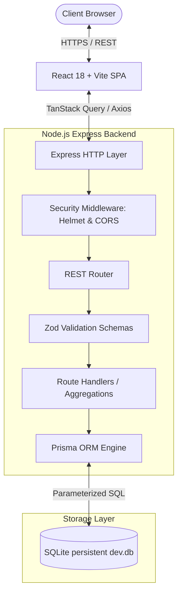
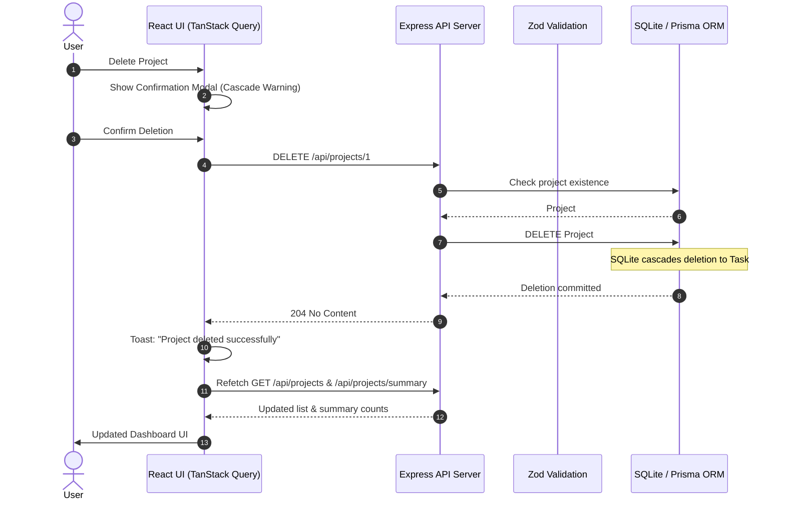
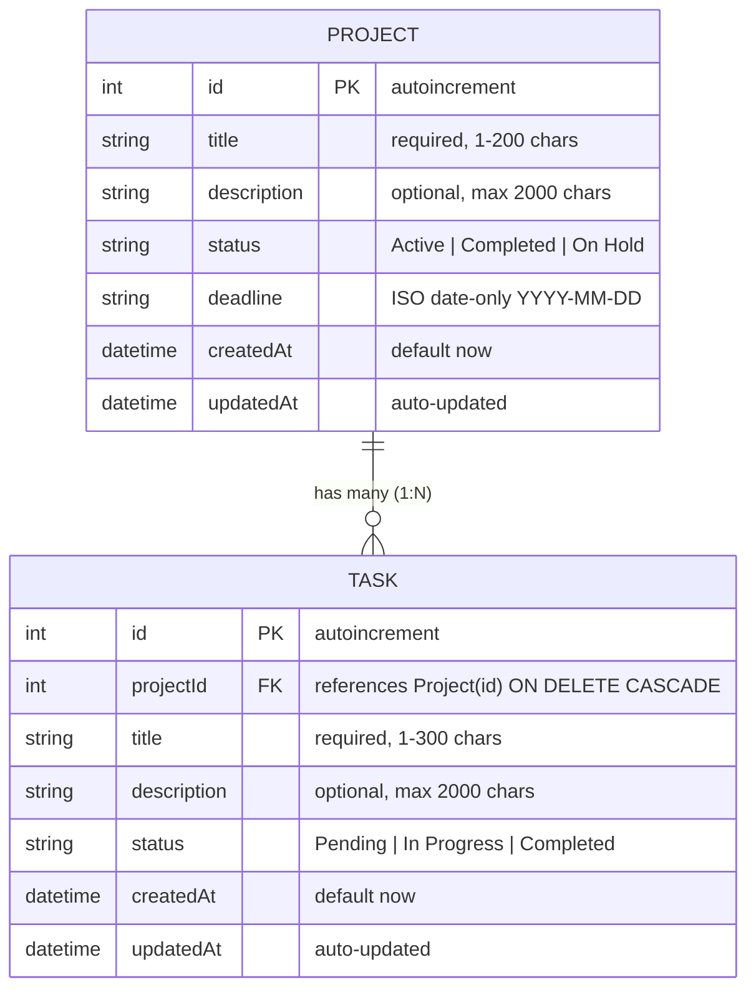
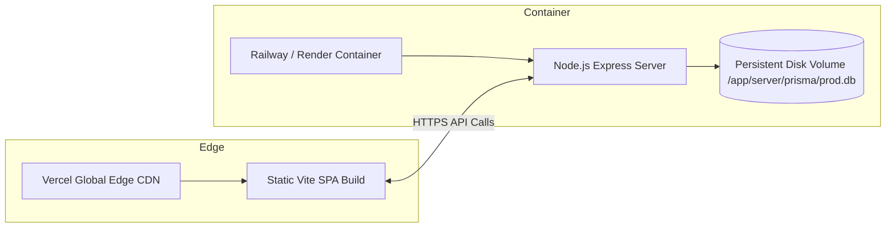

# System Architecture — EnvisionStudio Dashboard

## 1. High-Level Architecture Overview

EnvisionStudio Dashboard is built as a **modular monolith** with clear separation of concerns across client, server, and persistent database layers.

---

## 2. Request and Data Flow

1. **Query Lifecycle**:
   - User navigates to a route (e.g. `/projects`).
   - TanStack Query evaluates cache validity (`staleTime: 30s`). If stale or uncached, it triggers Axios.
   - Axios sends `GET /api/projects?status=Active` with `Content-Type: application/json`.
   - Express server passes the request through `helmet` and `cors` allowlist middleware.
   - `projectStatusFilterSchema` validates query parameter `status`.
   - Route handler executes `prisma.project.findMany` with `_count: { tasks: true }` and completed task projections.
   - Response returned in standardized envelope `{ data: [...], total: n }`.
   - TanStack Query caches data and React renders responsive cards.

2. **Mutation & Cascade Lifecycle**:
   - User deletes a project via UI confirmation modal.
   - React sends `DELETE /api/projects/:id`.
   - Server validates integer `id`, checks project existence, and executes `prisma.project.delete({ where: { id } })`.
   - SQLite enforces foreign-key `ON DELETE CASCADE`, deleting all child tasks atomically.
   - Server responds with HTTP `204 No Content`.
   - Client invalidates `['projects']` cache query keys, prompting background refetch of summary metrics and project list.

---

## 3. Data Model & Relationships

### Relational Integrity & Cascade Rules
- **Foreign Key**: `Task.projectId` references `Project.id` with `onDelete: Cascade`.
- **Cross-Project Protection**: All task updates and deletions scoped to `/api/projects/:projectId/tasks/:taskId` explicitly verify that the targeted task belongs to the given `projectId`. Cross-project modification attempts return HTTP `400` with code `CROSS_PROJECT_TASK_MISMATCH`.

---

## 4. Date and Timezone Architecture

- **Problem**: Storing dates as UTC `DateTime` objects causes one-day offset errors when rendered in browser timezones west of UTC (e.g. `2026-08-15 00:00:00 UTC` renders as `Aug 14, 2026 8:00 PM EDT`).
- **Solution**:
  - Backend stores deadlines as ISO date-only strings (`YYYY-MM-DD`).
  - Validation requires format `/^\d{4}-\d{2}-\d{2}$/`.
  - Frontend parsing utility uses `new Date(Date.UTC(year, monthIndex, day))` and formats with `timeZone: 'UTC'`.
  - Guarantees 100% fidelity across all global timezones.

---

## 5. Deployment Topology

- **Frontend**: Hosted on CDN-backed static hosting (Vercel / Netlify).
- **Backend**: Hosted on a container platform supporting durable disk volumes (Railway / Render).
- **Storage**: SQLite stored on persistent volume mount so data survives container redeployments.
